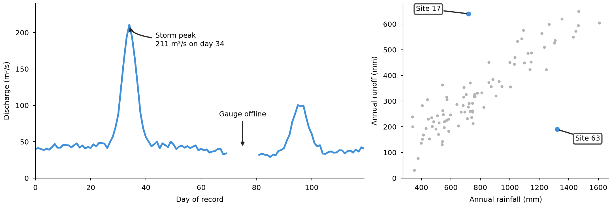

# Callout annotation

A callout puts a name or a value next to one feature of the data and joins the two with a leader line. Use it when a legend entry could not say which point is meant, such as a peak or a gap in a time series or a few named sites in a scatter. Draw the named points in color and the others in gray.

- `xytext` with `textcoords="offset points"` places the text a fixed printed distance from `xy`, so the leader keeps its length when the axis limits change. Point each offset into empty space.
- `LEADER` sets the line: `arrowstyle="-|>"` draws an arrow, `"-"` a plain line, and `shrinkB` leaves a gap in points before the target.
- `connectionstyle="angle3,angleA=0,angleB=90"` bends the leader. Omit it for a straight line.
