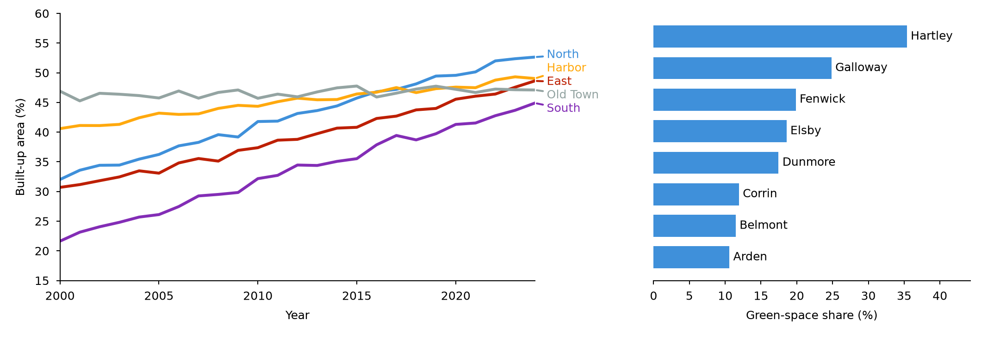

# Direct labels

Direct labels name each series at its data, so the reader does not have to match colors against a legend. The left panel writes each district's name at the end of its line, in the line's color. Where line ends crowd together, `spread` moves the labels apart and a short leader joins each label to its line. The right panel writes each city's name at the end of its bar, so the y axis needs no tick labels.

- `LABEL_GAP` is the smallest distance between label centers, in points. Convert it to data units after `fig.canvas.draw()`, because the conversion depends on the drawn axes height.
- Set fixed margins with `subplots_adjust`. Constrained layout resizes the axes after the labels are placed, and the gap no longer holds.
- `annotation_clip=False` keeps labels outside the axes visible. In `labeled_bars`, `bar_label(bars, labels=...)` writes the names and `set_xlim` leaves room for the longest one.
