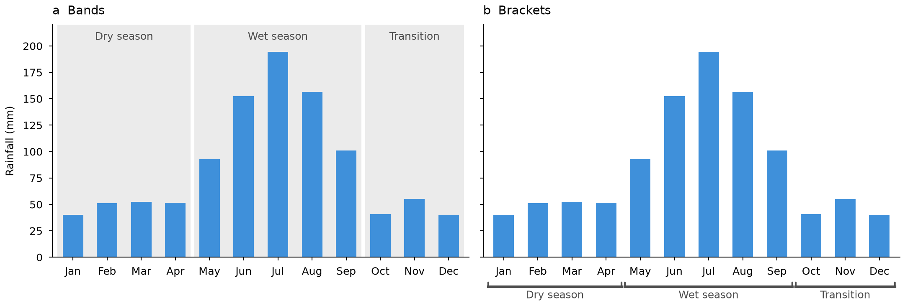

# Group bracket

A group label names a run of consecutive categories, such as the months of a season. Use it when the caption refers to the group by name. Shaded bands (a) mark each group across the full plot height. Brackets under the category labels (b) mark the same groups and leave the plot area clear.

- Each `GROUPS` entry is a label with its first and last category. `HALF` sets how far a band or bracket reaches past them; below 0.5 it leaves a gap between neighboring groups.
- Bands and labels use `get_xaxis_transform()`: x in data units, y as a fraction of the axes height. They keep their place when the y-limits change.
- In `brackets`, `drop` and `tip` are in points, so the gap below the tick labels stays the same at any panel height. The lines need `clip_on=False` to draw outside the axes.
