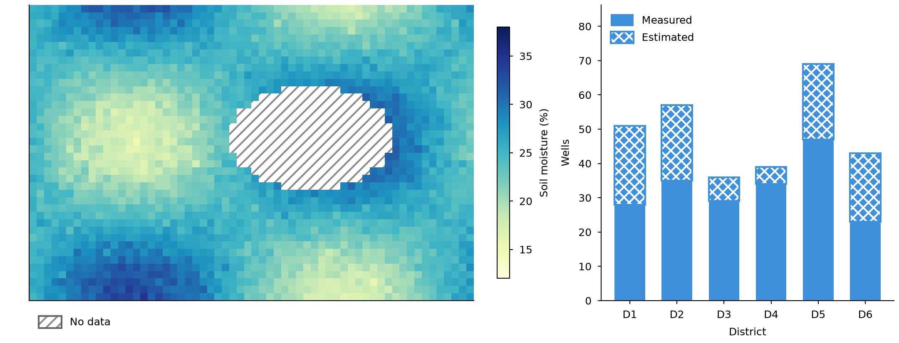

# Hatched fill

Hatch an area that must stand apart from every color of the scale. Two common cases are grid cells without data and a class that shares its fill color with another. Here gray hatching marks a gap in a gridded field and is keyed as "No data", and white cross-hatching marks the estimated part of each bar, which has the same blue as the measured part.

- `no_data_hatching` draws one hatched rectangle below the mesh (`zorder=0`). Masked cells are not drawn, so the hatching shows only where data are missing.
- `NO_DATA_HATCH` and `CLASS_HATCH` set the pattern; repeat a character (`"////"`) for denser lines. The `hatch.linewidth` rcParam sets the stroke width for the whole figure, not per patch.
- `hatchcolor` needs matplotlib 3.10 or later; without it, the hatch takes `edgecolor`. Give the legend `Patch` the same `hatch` and `hatchcolor` as the area it keys.
