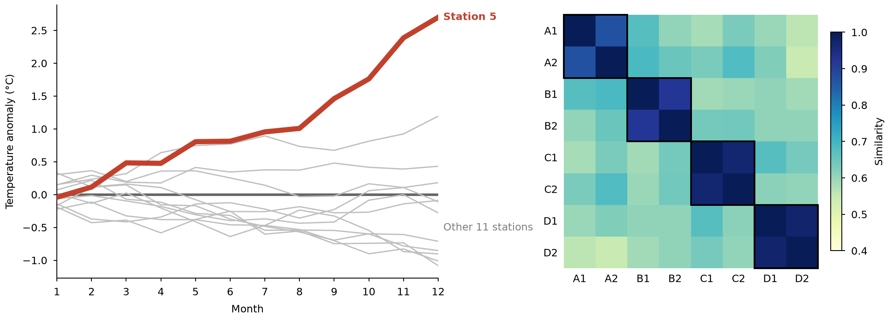

# Highlighting

Highlighting draws one series or one group strongly and keeps the others as muted context. Use it when the figure is about one item but readers still need the rest for comparison. In a line chart, give the focus line a strong color, a heavier stroke and a label at its end instead of a legend. In a matrix, outline the group and leave the cell colors alone, because they still encode values.

- Draw the focus line last, with the higher `zorder` in `FOCUS`, so no muted line crosses it.
- `imshow` puts cell edges at half-integers, so each rectangle starts at `start - 0.5`.
- Set `clip_on=False` on the rectangles. Otherwise the axes clip the outer edges of the corner blocks to half their width.
