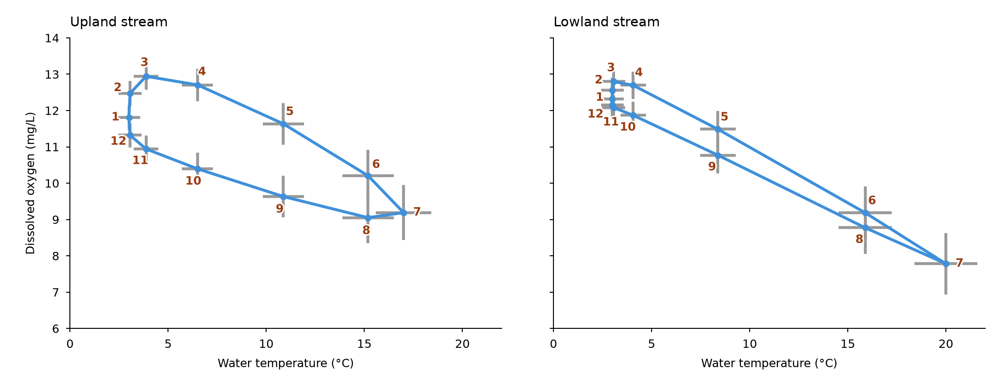

# Point labels

Point labels number the points of a path, here the twelve months of a seasonal loop. Use them when the order of the points matters and a legend or color bar would take too much room. Each numeral sits outside the loop, so it does not cover the line, the error bars or another numeral.

- `outward_normals` points each label away from the loop, at right angles to the path. It uses the sign of the loop's area, so it works for clockwise and counter-clockwise loops.
- `spread_labels` keeps label centers `LABEL_GAP` apart and `CLEARANCE` from the line. A label pushed farther than `LEADER_FROM` from its point gets a leader line.
- `to_points` works in printed points. Set the axis limits and the final layout before you call `number_months`; with constrained layout the axes would move afterwards.
