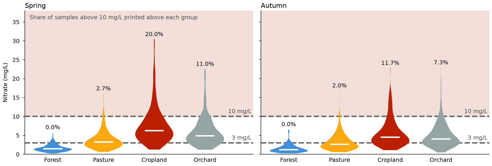

# Reference band

A reference band shades a range of values, such as the range above a class threshold, behind the data. Use it when readers compare distributions against fixed classes rather than only against each other. Dashed lines mark the thresholds. The number above each distribution is the share of its samples above `UPPER`, computed from the plotted samples.

- `LOWER` and `UPPER` set the threshold lines and their labels; `UPPER` also sets where the band starts and which share is printed.
- `axhspan` does not grow when the y-limits change later. Compute the upper limit first (`top` in `main`) and pass it to `draw_season`, so the band reaches the top of the axes.
- The threshold labels sit at the right edge of the axes. `set_xlim` leaves an empty strip right of the last group to hold them.
