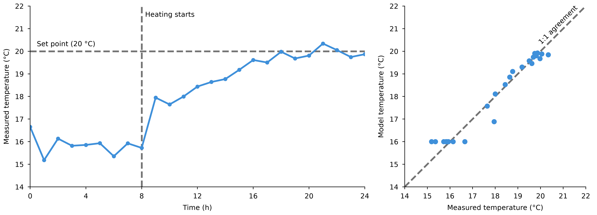

# Reference line

A reference line marks a value that readers compare the data against. Use a horizontal line for a target, a vertical line for an event and a 1:1 line when paired measurements share units. Draw the line below the data, and put its label on a stretch of the line that no data cross.

- `SET_POINT` and `START_HOUR` move each guide and its label together.
- The target label uses `ax.get_yaxis_transform()`: x is a fraction of the axes width, y is in data units. The event label uses `get_xaxis_transform()`, the other way round.
- The 1:1 label is rotated by 45°, so `agreement` needs `aspect="equal"` and the same limits on both axes.
