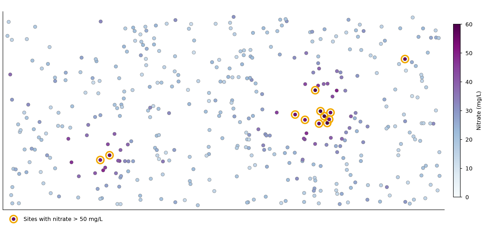

# Ring marker

A ring marker circles the points that meet a stated condition, such as a concentration above a limit. Use it when color already encodes the value and readers must see which points pass the threshold without judging shades. The ring sits outside the dot, so the dot's color stays readable, and the legend states the condition.

- `RING_COLOR` must not occur in `CMAP`. The legend text is built from `LIMIT`, so the two always agree.
- `DOT_AREA` and `RING_AREA` are scatter areas in points². The ring's diameter, `sqrt(RING_AREA)`, must exceed the dot's by more than the ring's stroke width, or the ring covers the dot.
- Draw all dots, then the rings, then the ringed dots again on top. In the legend, `HandlerTuple(ndivide=1)` overlays the ring on the dot; `ndivide=None` would place them side by side.
