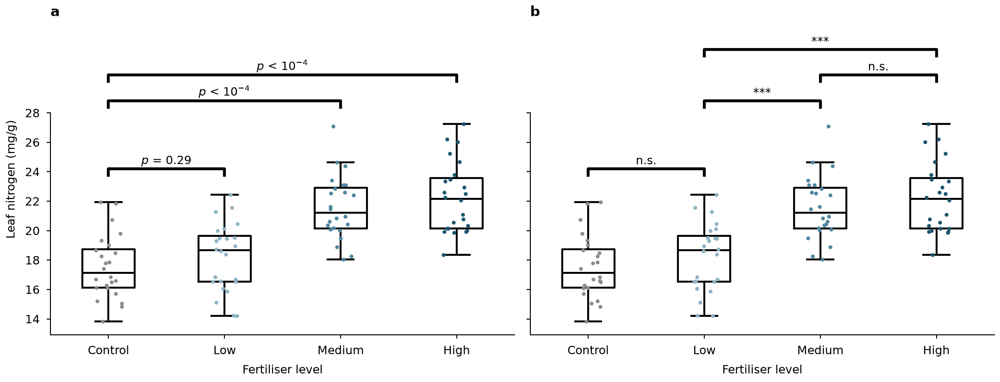

# Significance marker

Significance brackets report a few chosen pairwise tests above grouped distributions. Each bracket joins two groups and carries a p-value (panel a) or stars (panel b). Draw only the pairs the study tests. The snippet does not adjust p-values for multiple comparisons, so state the test and any adjustment in the caption.

- `permutation_p` cannot return less than 1 / (`N_PERMUTATIONS` + 1). `format_p` reports that floor as an upper bound ("p < 10⁻⁴"); raise `N_PERMUTATIONS` to resolve smaller p-values.
- `stack_brackets` places shorter spans first. Each bracket sits one `STEP` above the data it spans and above every placed bracket that shares a group with it, so the order of the pairs in `main` does not matter.
- Panels that share a y axis need room for the taller bracket stack. `draw_brackets` returns the limit it needs, and `main` applies the larger of the two.
