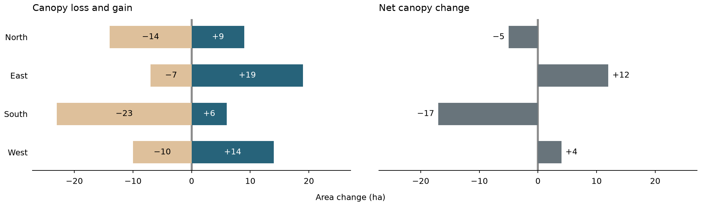

# Data labels

Data labels print each bar's value on or next to the bar. Use them when readers need exact numbers, for example when a small net change hides large gains and losses. Here the left panel prints each gain and loss inside its segment, and the right panel prints the net change past the bar tip.

- `LOSS` holds one negative and `GAIN` one positive value per row. Both panels share one x-range, symmetric around zero.
- `bar_label(..., label_type="center")` centers a number in its segment. Choose its `ink` together with the bar `fill`, so the number stays readable.
- With the default edge placement, `padding` is the gap in points beyond the bar tip. Matplotlib puts labels of negative bars left of the tip and labels of positive bars right of it.
