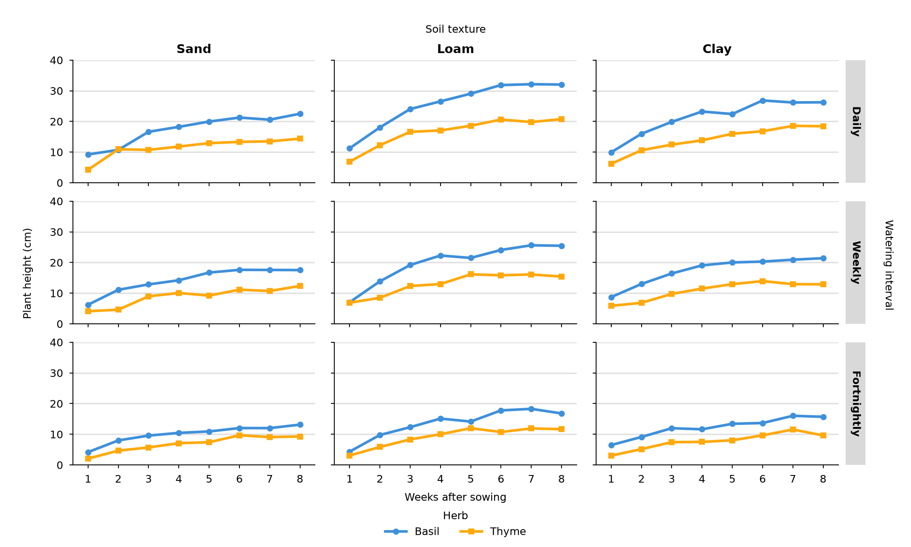

# Facet grid

A facet grid gives one panel to each combination of two categorical variables, for example soil texture by watering interval. Each level is named once: column titles on top and row names in shaded strips at the right edge. All panels share their axes, and one legend covers the series drawn in every panel. With only one facet variable, give each panel its own title instead.

- `SOILS` sets the columns and `WATERING` the rows; the grid size follows their lengths.
- `row_strip` converts `STRIP_MM` and `GAP_MM` to axes fractions from the panel's current position. Call it after `fig.subplots_adjust`, which sets that position.
- `right` and `bottom` in `subplots_adjust` reserve the room for the strips, the row variable name and the legend.
