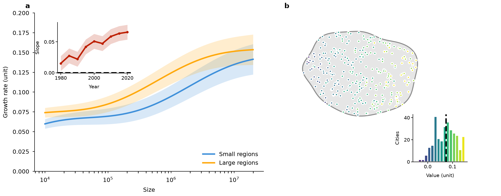

# Inset chart

An inset chart is a small chart with its own axes, drawn in an empty corner of another panel. Use it when the second view belongs to that panel, such as a quantity derived from the main curve or the distribution of the mapped values. Label the inset's axes, because it has its own scales and units. A histogram inset on a map can color its bars with the map's color scale and so serve as the color key.

- `ax.inset_axes([x, y, w, h])` takes fractions of the parent axes. The inset's tick and axis labels fall outside that box, so leave room for them too.
- `axins.patch.set_alpha(0)` makes the inset background see-through. Keep it opaque when gridlines or data lie behind the inset.
- For a histogram key, share `NORM` and `CMAP` between the points and the bars. Clip the values to `NORM` before binning, so the end bars hold everything beyond the scale.
