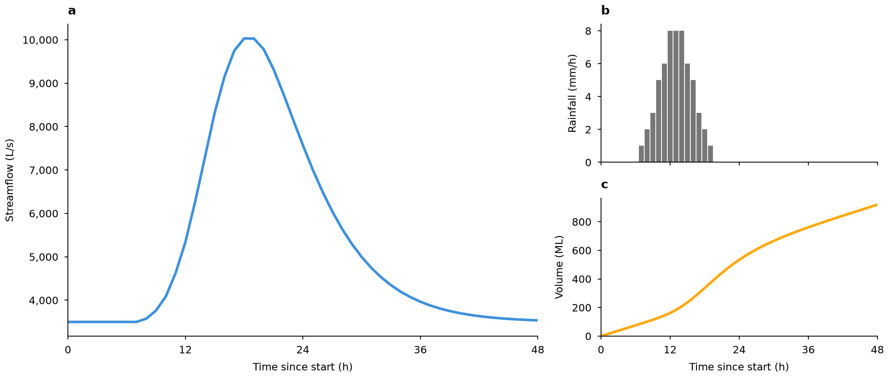

# Panel labels

Panel letters let the caption and the text refer to single panels. `panel_label` puts each letter at a fixed distance in points from the upper-left corner of its axes. The letters therefore line up the same way on panels of different size and with tick labels of different width.

- `xy=(0, 1)` with `xycoords="axes fraction"` picks the upper-left corner. `xytext` in `"offset points"` sets the printed gap.
- The order of the axes in the `zip` in `main` decides which panel gets which letter.
