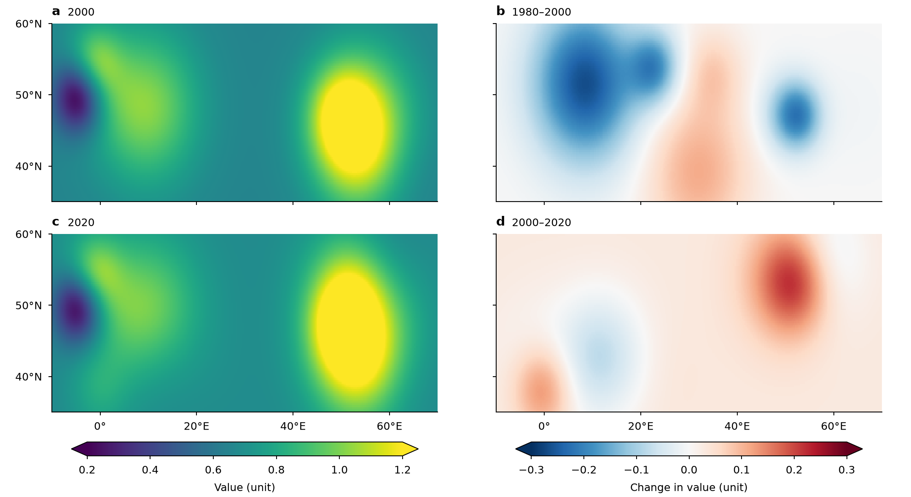

# Shared color bar

A shared color bar serves several panels that show the same quantity on one scale, so a color means the same value in each panel. Here each column has its own quantity and its own bar: a value on a sequential scale on the left, and a change on a diverging scale on the right. Each bar sits under the column it serves.

- Pass the same `Normalize` object (`VALUE`, `CHANGE`) to every panel that shares a bar. Without it, each `imshow` scales to its own minimum and maximum, and the bar is right for one panel only.
- Give a diverging scale an equal range on both sides of zero, so the middle color marks no change.
- `fig.colorbar(image, ax=axes[:, 0], ...)` places one bar along all panels of a column. Pass `ax=axes` for one bar under the whole grid.
