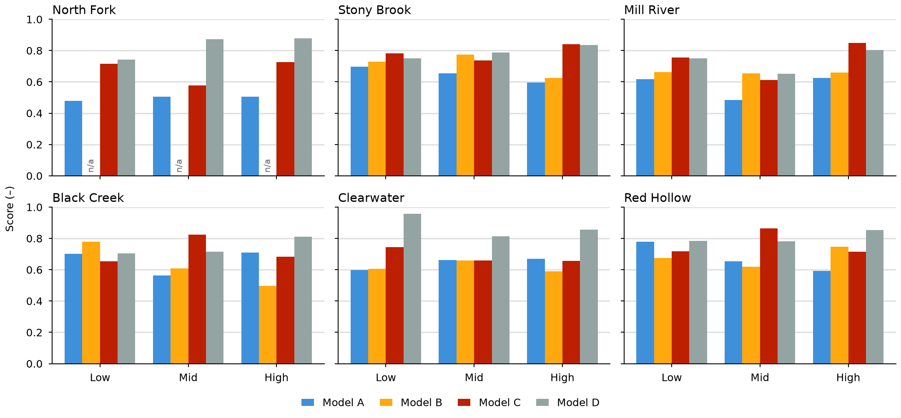

# Shared legend

Use one figure legend when several panels use the same colors or markers for the same categories. The legend names each category once, so readers do not have to check that the colors match from panel to panel. This works only if every panel takes its colors from one mapping. Mark a category that has no result in a panel ("n/a"), so its empty slot does not read as zero.

- `MODELS` maps each category to its color. Every panel reads from it, and the legend follows its order.
- `shared_legend` collects handles from every panel and keeps the first one for each label. Taking the handles of one panel would drop a category missing from that panel.
- `loc="outside lower center"` needs matplotlib 3.7 or later and `layout="constrained"`; the panels shrink to make room.
