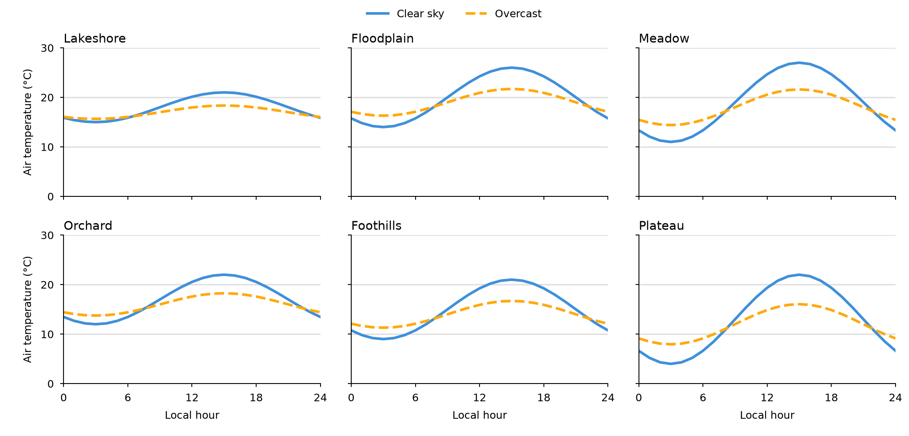

# Small multiples

Small multiples repeat one chart per group, here one panel per site, on the same scales. Use them to compare shapes across groups, such as when a daily cycle peaks and how far it swings. Shared axes make positions comparable from panel to panel, and one legend serves the whole grid.

- With `sharex=True, sharey=True`, every panel takes the limits and ticks set on `axes[0, 0]`. `label_outer()` keeps axis and tick labels on the bottom row and the left column.
- `fig.legend` takes its handles from the first panel, so every panel must draw the series with the same labels and styles, as `draw_site` does.
- Light horizontal grid lines (`ax.grid(axis="y")`) carry the tick levels to panels far from the tick labels.
