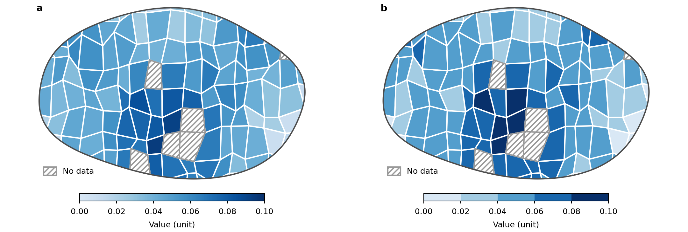

# Choropleth map

A choropleth fills each area, such as a district or a country, by its value. Use it for rates and shares, not counts: large areas draw the eye whatever their value. Panel a uses a continuous color scale, and panel b sorts districts into classes with `BoundaryNorm` so readers can read a class off the map. Hatch areas without data so they are not read as the lowest value.

- Replace `districts` with real polygons, a list of `(n, 2)` lon/lat arrays; `PolyCollection` takes the list as it is. `set_clip_path` cuts them at the country outline without a geometry library.
- `BREAKS` sets the classes of panel b and the ticks of both color bars, so both panels read on one scale.
- `CMAP` leaves out the near-white end of `Blues`. Keep the lowest class darker than the white background and the white of the `NO_DATA` fill.
