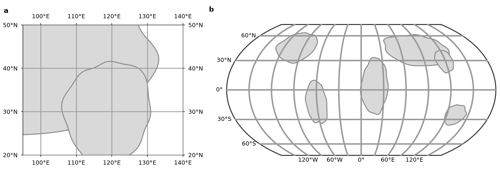

# Graticule

A graticule draws lines of latitude and longitude on a map. Use it when readers need to read positions off the map or match places between panels. Panel a is a map in plain longitude and latitude, where the graticule is the axes grid and degree labels repeat on all four sides. Panel b is a world map in the Equal Earth projection, where the lines are projected and labeled by hand outside the map edge.

- `equal_earth` turns degrees into map coordinates. Every element of b goes through it: land, lines, frame and label anchors. Any projection written as a function of lon and lat can replace it.
- In b, the frame draws meridians ±180, so the graticule leaves them out. Set the limits slightly beyond the projected extent; limits exactly at the frame cut off half of its line.
- `set_axisbelow(False)` draws the grid over filled land; `True` hides it under filled areas.
