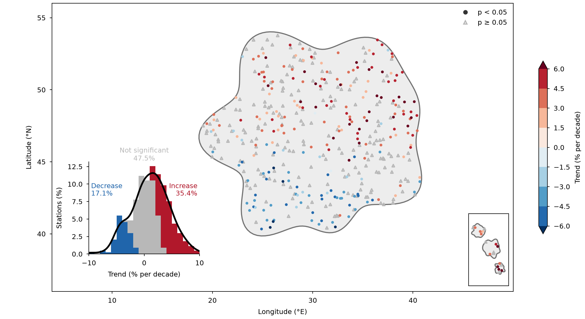

# Inset map

Use a framed inset map when part of the mapped area lies far from the rest and extending the main map to include it would shrink everything else. Draw the inset at the main map's scale, with a frame and no ticks or connectors. An empty corner can hold a histogram of the mapped values when the share of stations in each class matters as much as where they are.

- `MAIN_EXTENT` and `ISLAND_EXTENT` are `(lon_min, lon_max, lat_min, lat_max)`. `island_inset` sizes the inset from their ratio, so one degree has the same length in both maps.
- An `inset_axes` rectangle covers only the plotting area, in fractions of the parent axes. Tick and axis labels fall outside it, so place the histogram far enough inside the map.
- `CLASSES` gives the map markers and the histogram bars the same color per class. `trend_histogram` multiplies the density by the bin width and 100 so the curve shares the bars' percent scale.
