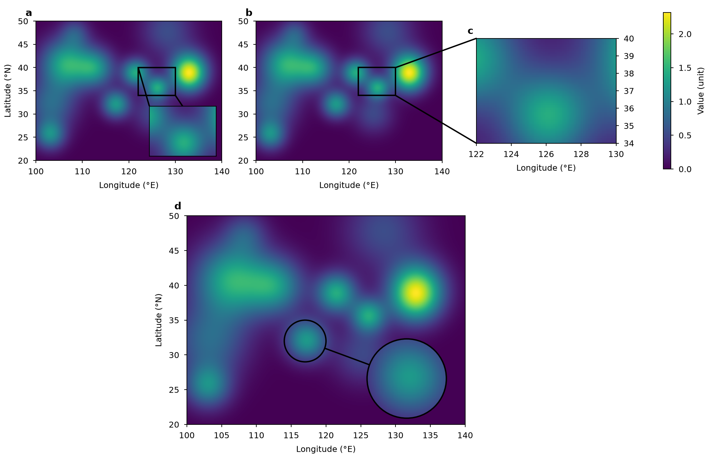

# Zoom inset

A zoom inset shows one region of a map at a larger scale and marks where that region lies on the overview. All panels share one color scale (`vmin` and `vmax` in `IMSHOW`), so one color bar serves them all.

- (a) The detail sits inside the overview, in an empty corner.
- (b, c) The detail gets its own panel, with its own ticks; several regions can be zoomed.
- (d) A circle, for a region with no natural rectangle.

The examples use longitude and latitude in degrees.

- `ZOOM` is `(lon_min, lon_max, lat_min, lat_max)` and `CIRCLE` is `(lon_center, lat_center, radius)` in degrees. Keep each inset clear of the region it magnifies.
- Call `join_circles` after the color bar and labels exist. It measures the direction between the circles on the drawn page.
- Clipping the image to a `Circle` does not clip the axes background or frame, so the circular inset needs `axins.axis("off")`.
