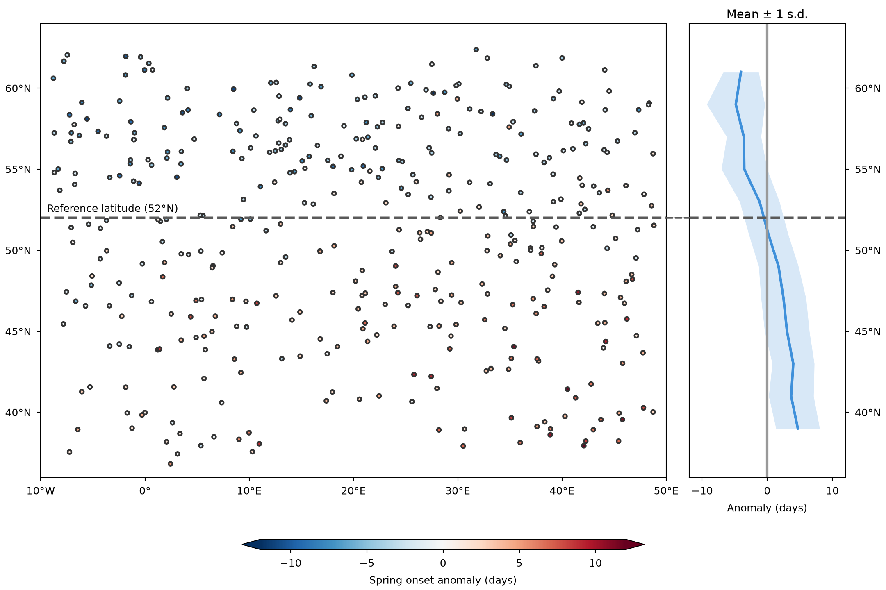

# Latitude profile

A latitude profile sits beside a map and shows how the mapped values change with latitude. The narrow panel shares the map's latitude axis, so each bin mean lies level with the stations it sums up. Use it when the values change mainly from south to north. One `LIMIT` sets both the color scale and the profile's x range, so colors and positions share one scale.

- `latitude_profile` returns the mean and standard deviation per `BIN_WIDTH` bin and drops bins with fewer than `MIN_STATIONS` stations. If you use a median or a confidence interval instead, change the panel title to match.
- `match_height` sets the profile's box aspect from `WIDTHS` so both panels have the same height. Attach the color bar to both axes (`ax=[ax_map, ax_profile]`); attached to the map alone, it shortens the map column and the panels no longer line up.
- `GUIDE` sets `"snap": False`. `axhline` snaps to whole pixels and `ConnectionPatch` does not, so without it the connector from `bridge` sits a pixel off the dashed lines.
