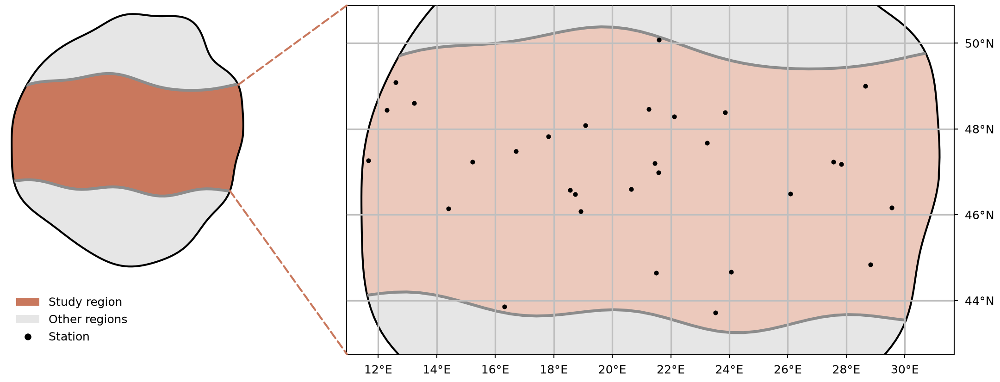

# Locator map

A locator map shows where a study region lies within a larger area. Use it when readers may not know the region. The locator fills the study region among muted neighbors, and dashed connectors join it to a detail map of the region.

- `draw_regions` clips each region band to the outline with `set_clip_path`, so neighboring regions share their borders exactly without a geometry library.
- `connect` starts the connectors at the region's north-east and south-east tips and ends them at the detail map's left corners. Change both if the detail map sits on another side.
- Both maps have a fixed aspect, so constrained layout leaves spare width. `set_anchor("W")` on the locator and `set_anchor("E")` on the detail map move it into the gap the connectors cross.
