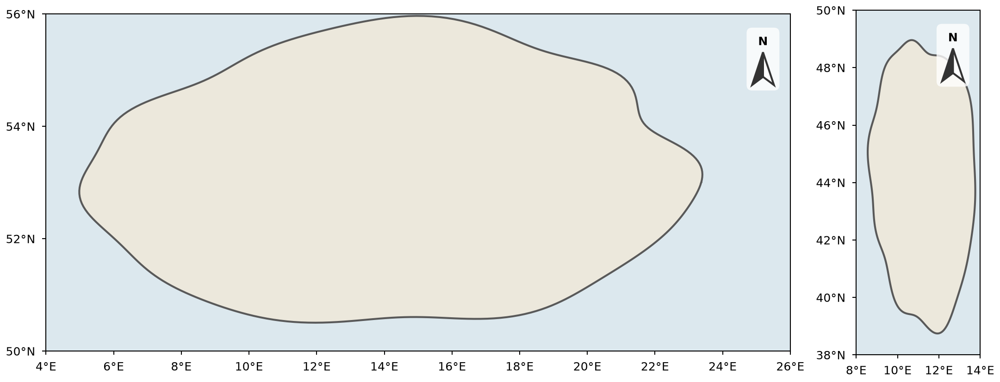

# North arrow

A north arrow shows which way is north on a map without a graticule, or where the orientation is not obvious. On longitude–latitude axes, north points straight up everywhere. Anchor the arrow at a corner of the axes and size it in millimeters, so it keeps its size and margin on maps of any shape.

- `CORNER` is the anchor in axes fraction, and `OFFSET_MM` moves the arrow's base center from it in millimeters. For the lower left, use `CORNER = (0, 0)` with a positive offset.
- The transform in `north_arrow` chains `Affine2D` (millimeters to inches), `fig.dpi_scale_trans` (inches to pixels) and `ScaledTranslation(*xy, ax.transAxes)` (the anchor). The shape does not stretch with the aspect or the data limits.
- The white `FancyBboxPatch` backing keeps the arrow readable over coastlines. The arrow does not rotate, so it does not suit projected maps where north changes direction across the map.
