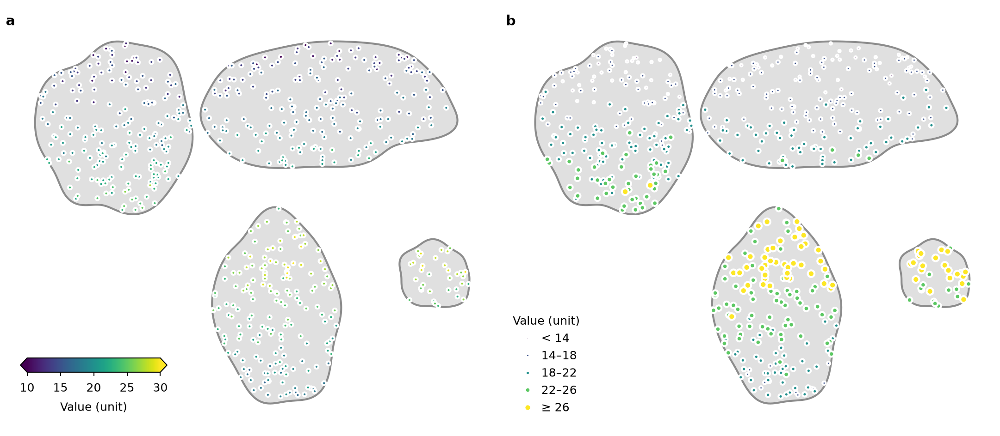

# Point map

A point map draws one marker per place, such as a city or a station, on a plain base map. Use it when each value belongs to a place rather than to an area or a grid cell. Show the value by color alone when points are dense (a). Show it by color and size in classes when readers should find the high classes at a glance or the figure may be printed in gray (b).

- `point_map` draws points in order of value, so high values sit on top where points overlap.
- In **b**, `BoundaryNorm(CLASSES, ...)` gives each class one color and `SIZES` gives it one marker area in points². The end classes also hold values beyond the outer edges, so label them as open ranges, such as "< 14", not as closed ones.
- `aspect="equal"` draws a degree of longitude as long as a degree of latitude. For a regional map, use `1 / cos(mean latitude)`.
