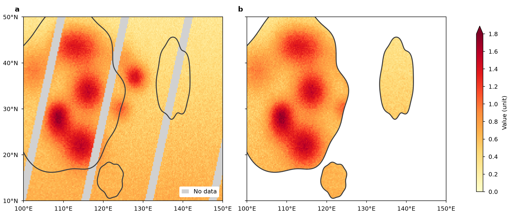

# Raster map

A raster map draws a value given on a regular grid, such as satellite retrievals or model output, as one colored cell per grid cell, with coastlines on top. Panel a shows the whole grid and draws cells without data in a gray that is not in the color map. Panel b masks the grid to land and leaves the sea white, for values that are not defined outside the mask. Both panels use one `NORM`, so one color bar holds for both.

- `pcolormesh` takes the cell edges (`LON_EDGES`, `LAT_EDGES`), not the centers. Masked cells (`np.ma.masked_where`) take the color set by `with_extremes(bad=...)`.
- `land_mask` keeps a cell when its center is on land, which leaves steps one cell wide along the coast. For a smoother edge, use a finer grid or clip the mesh to the land outline with `set_clip_path`.
- `rasterized=True` stores the cells as one image in a vector PDF, while coastlines and text stay vector. Without it, a fine grid writes one vector patch per cell.
