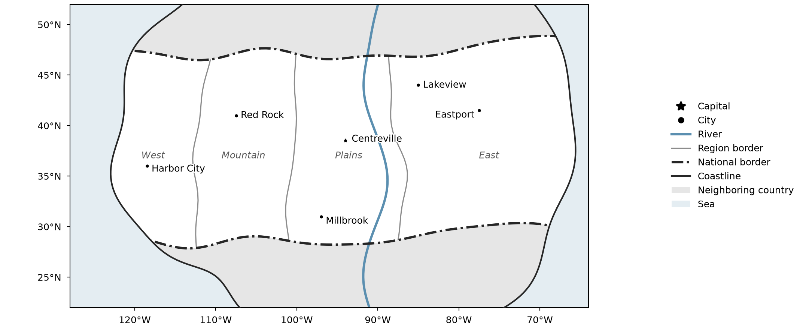

# Reference map

A reference map shows where the regions, cities or sites named in a paper lie. Nothing on it encodes a value, so a key that names each fill and line is enough. Use it before other figures report values for those places. Region names are gray italics so they do not read as city names, and city labels have a white halo so they stay readable where they cross a line.

- For a real map, replace `blob`, `country_band` and `region_bands` with real outlines as `matplotlib.path.Path` objects in lon/lat.
- Paint the whole continent in the neighbor color, then paint the country over it, clipped to the continent with `set_clip_path`. Country and neighbors then meet exactly at the national border.
- `CITIES` and `CAPITAL` hold each label's offset in points and its alignment. Place labels to the side of the marker with `ha="left"` or `"right"`, away from lines and other labels.
