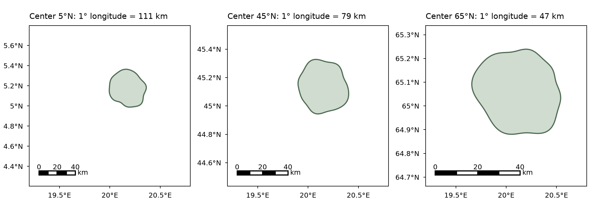

# Scale bar

A scale bar lets readers measure distances on a map with degree axes. One degree of longitude spans π/180 × R × cos(latitude) km: 111 km at the equator and half that at 60°N. A bar of fixed length in kilometers therefore covers more degrees of longitude toward the poles. On a map that spans many degrees of latitude, the bar is true only at its own latitude, so place it near the area it measures.

- `scale_bar` evaluates `km_per_degree_lon` at the bar's latitude, taken from `BAR_XY`. Do not use 111 km per degree of longitude away from the equator.
- `BAR_XY` and `BAR_HEIGHT` are axes fractions. A blended transform puts the bar's x in degrees and its y in axes fraction.
- `set_aspect(1 / cos(lat))` makes a kilometer east–west as long on paper as a kilometer north–south, at the map's center latitude.
