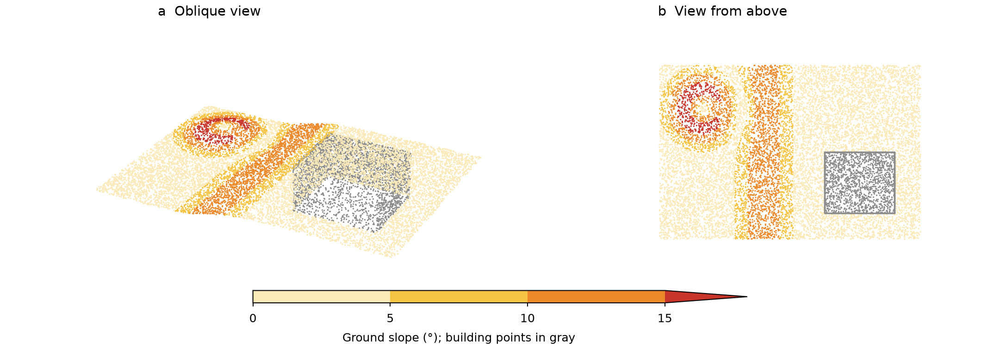

# 3-D view

A 3-D view draws a point cloud in perspective, with each point colored by a value measured on the scene. Use it when the shape of the scene matters along with that value. Pair an oblique view, which shows height, with a view from straight above, which shows position without points hiding each other. For the view from above, use `view_init(elev=90, azim=-90)` with `proj_type="ortho"`.

- `set_box_aspect` takes the scene extents in meters, so there is no vertical exaggeration. To exaggerate height, multiply the third entry and say so in the caption.
- `depthshade=False` keeps every point in its class color. With depth shading, far points fade and look like a lighter class.
- 3-D axes leave room for any rotation, so the scene looks small. `zoom` in `set_box_aspect` enlarges it, and `clip_on=False` on the scatters lets its corners reach past the axes box.
