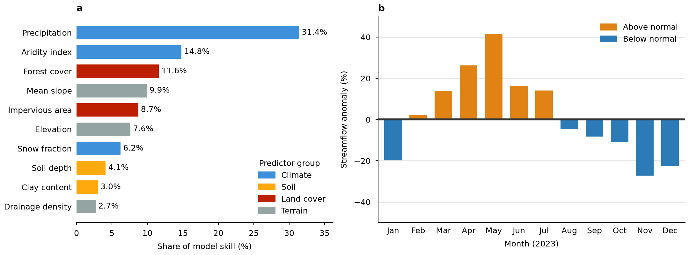

# Bar chart

A bar chart compares one value across categories. The bar length from zero carries the value, so the value axis must start at zero. Panel a sorts horizontal bars for unordered categories with long names and prints each value at the bar end. Panel b colors signed bars by sign along an ordered axis, with symmetric limits so equal values above and below zero get equal lengths.

- `barh` draws the first entry at the bottom, so `sorted_bars` sorts in ascending order to put the largest bar at the top.
- `bar_label(..., padding=2)` sets the gap in points between the bar end and its value. `set_xlim(0, 1.15 * max(values))` leaves room for the longest label.
- In `signed_bars`, a value of exactly zero takes the "Above normal" color.
