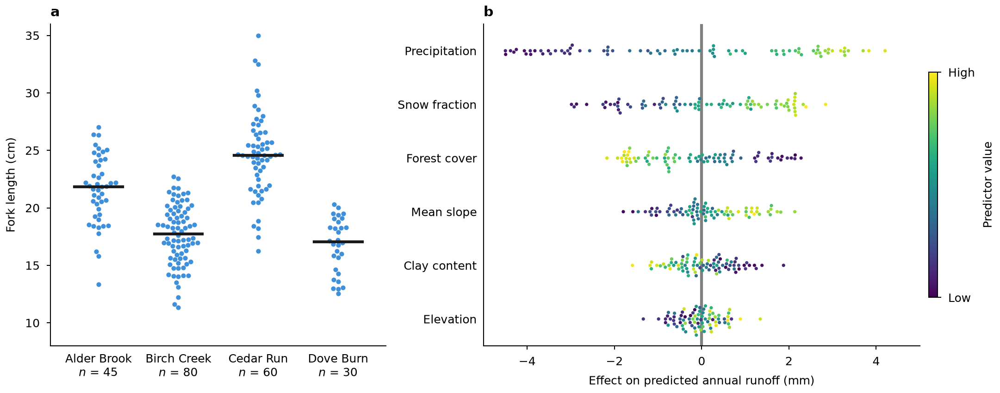

# Beeswarm plot

A beeswarm plot shows every value as its own point and moves each point sideways only as far as it must to clear the others, so the swarm's width at any value follows the number of points there. Use it for tens to a few hundred values per category, where random jitter would let markers overlap. Panel a shows vertical swarms by category with the median. Panel b shows one row per predictor, colored by the predictor's value, as in SHAP plots.

- `swarm` takes values and a marker diameter in the same units (points here) and returns sideways offsets in those units.
- `points_per_unit` reads the drawn axes size, so call the swarm functions after `fig.canvas.draw()`. Set labels, limits and color bars before that call; if the axes size changes afterwards, markers can overlap.
- A swarm wider than half the category spacing runs into its neighbor, and `main` raises an error then. Reduce `SIZE` or the number of points, or give the panel more room.
