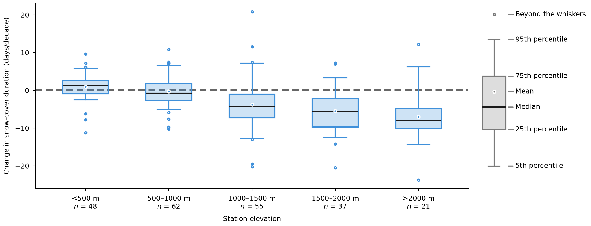

# Box plot

A box plot compares the center and spread of one variable across a few categories. Whiskers have no single convention: they may reach 1.5 × IQR, fixed percentiles or the extremes. State the rule in a key beside the plot and in the caption, and name every element drawn, including the mean marker and the points beyond the whiskers.

- `WHIS` sets the whisker ends as percentiles, and `box_key` reads its labels from it. For Tukey's rule, pass `whis=1.5` and change the key labels to "1.5 × IQR".
- With percentile whiskers, the points beyond them are a fixed share of every category (10% for 5–95), not outliers by any test. Say so in the caption, or pass `showfliers=False`.
- `box_props` styles both the plot and the key. `box_key` draws with `ax.bxp` from fixed statistics, so the key needs no data.
