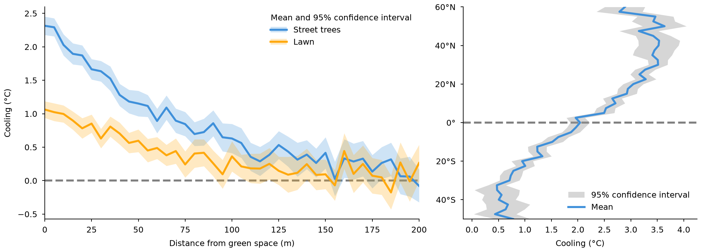

# Confidence band

A confidence band shades the interval around an estimated line, so readers see how certain the estimate is at each x. Use it when the uncertainty changes along the line and one number cannot describe it. Print what the band means, for example in the legend title, and draw each band in its line's color.

- `mean_and_ci` returns the mean and the half-width `Z95 × sd / √n`. With fewer than about 30 samples per x, replace `Z95` with the Student-t quantile.
- Draw each band before its line. Each legend key overlays the band patch and its line with `HandlerTuple(ndivide=1)`; a single gray key for colored bands matches none of them.
- For a vertical profile, `fill_betweenx(y, x_low, x_high)` fills along y and `plot(x, y)` draws the line.
