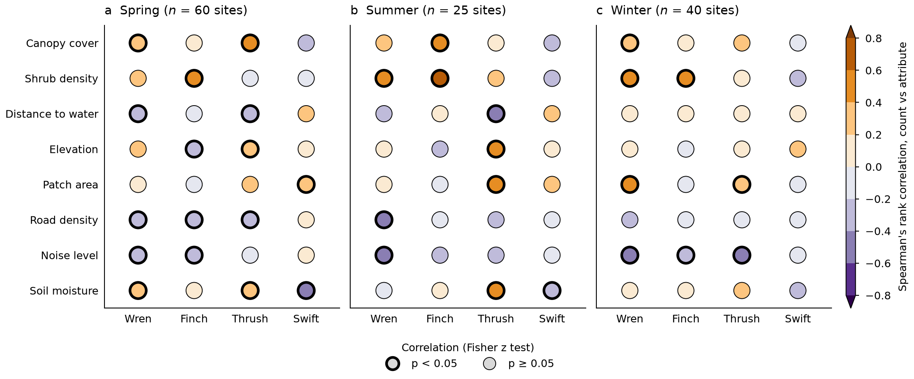

# Circle matrix

A circle matrix shows many correlations between attributes (rows) and groups (columns), with one facet per condition. Fill color gives the correlation on a discrete diverging scale centered on zero, and a thick outline marks a significant correlation. Significance depends on the sample size as well as on rho, so the same color can have different outlines in different facets. Give the outline its own legend and print each facet's sample size.

- Keep `BREAKS` symmetric about zero, with zero as an edge. With `BoundaryNorm(..., extend="both")`, the color map needs `len(BREAKS) + 1` colors.
- `scatter` takes one `linewidths` value per circle, so `outline` maps the significance mask straight onto edge widths. Keep a thin edge on circles that are not significant; without it, the pale classes next to zero almost vanish.
- `CIRCLE` is the marker area in pt² and does not scale with the figure. Check it against the cell size after you change `figsize`.
