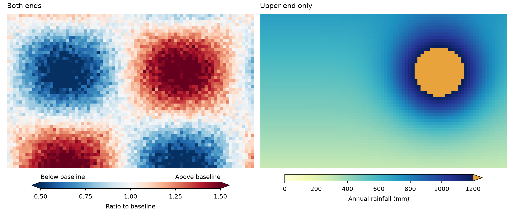

# Color bar extensions

Triangular ends on a continuous color bar mark values beyond the range the colors resolve. Use them when a few values fall outside that range and the range should not stretch to fit them. The left bar is diverging, centered on a reference, and open at both ends. The right bar is open at the upper end only, and values above the top get a color that is not in the map.

- `extend` (`"both"`, `"min"`, `"max"`) only draws the triangles. Values beyond the norm's `vmin` and `vmax` take the colormap's under and over colors either way.
- By default the under and over colors repeat the map's end colors, so a triangle reads as "this far or further". `with_extremes(over=...)` with a color outside the map makes the out-of-range cells stand out on the map too.
- Text on `colorbar.ax` uses axes coordinates where x = 0 and 1 are the ends of the bar body, not the triangle tips.
