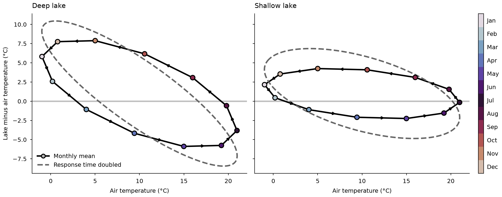

# Connected scatter plot

A connected scatter joins points in time order to show how two variables change together through a cycle, such as the months of a year. Use it when the relation depends on the season. When lake temperature lags air temperature, spring and autumn months with the same air temperature fall on opposite sides of the loop. Arrows give the direction, and the marker fill gives the month.

- `closed` repeats the first point so the line returns from the last month to the first. Leave it out when the series does not repeat. `ARROW_EVERY` thins the direction arrows when points are dense.
- `MONTH_CMAP` takes twelve colors from the cyclic `twilight` map, so December and January get neighboring colors. Its winter colors are near white; the black marker edge keeps them visible.
- A scatter's legend handle takes the fill of its first point. The legend uses hand-built `Line2D` handles with a neutral fill instead.
