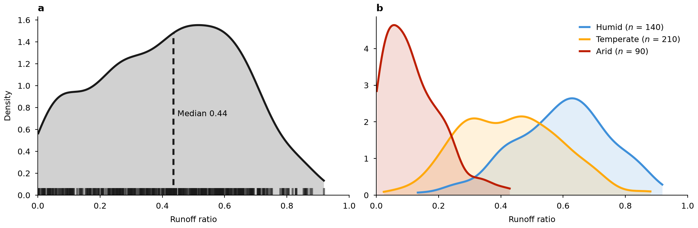

# Density plot

A density plot draws a smooth curve of a distribution's shape without choosing bin edges. Use it for one distribution, or to overlay a few groups with light fills and outlines in the group color. Each curve has an area of 1, so overlaid groups of different size compare shapes, not counts; print each group's count in the legend. For a bounded quantity, such as a ratio between 0 and 1, stop each curve at the smallest and largest observed value, so it shows no values that cannot occur.

- `kernel_density` uses a Gaussian kernel with Silverman's bandwidth times `BANDWIDTH_SCALE`. Above 1 it smooths more; below 1 it follows the data more closely. State the bandwidth in the caption.
- `curve` cuts the curve at `values.min()` and `values.max()` but does not rescale it, so near a bound the drawn area is slightly less than 1.
- `rug` draws one tick per value with `ax.get_xaxis_transform()`: x in data units, y as a fraction of the axes height. `RUG_HEIGHT` therefore does not change with the y scale.
