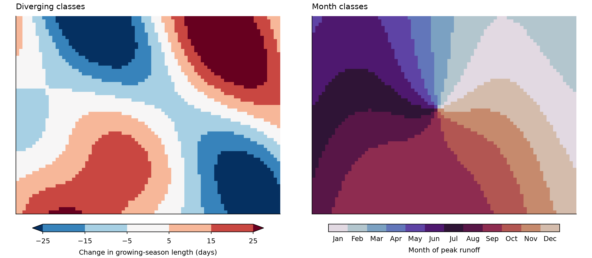

# Discrete color bar

A discrete color bar splits the scale into classes. Use it when readers should read a class from a color, not an exact value. The left bar has symmetric breaks around zero, a neutral middle class and end triangles for values beyond the outer breaks. The right bar has one class per month, labeled at the class center.

- `from_levels_and_colors(..., extend="both")` needs `len(BREAKS) + 1` colors: one per class, plus the under and over colors that fill the triangles. Use `extend="neither"` when no values fall outside the outer breaks.
- In `month_classes`, `BoundaryNorm(np.arange(0.5, 13), ...)` puts the class edges at half-months, so the ticks 1 to 12 fall at the class centers.
- `twilight` keeps the turn of the year continuous, but Dec, Jan and Feb come out near white and are hard to tell apart. Pick the colors by hand when the winter months must be told apart.
