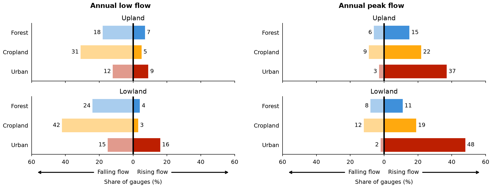

# Diverging bar chart

A diverging bar chart puts two opposite outcomes of each category back to back on either side of zero, such as the shares of gauges with falling and rising flow. Use it when both outcomes are measured in the same unit. Each region gets its own sub-panel, and all panels use one x scale. The tick labels give distances from zero, and arrows under the axis name the outcome on each side.

- `SHARES` holds one `(left, right)` pair per entry in `COVERS`, grouped by index and then by region. Each index becomes a column made with `subfigures`.
- The left bars are drawn with negative values. Format the ticks with `abs(x)` and pass unsigned `labels` to `bar_label`, or both will print a minus sign.
- `direction_arrows` places the arrow row `below` points under the axes with `offset_copy`. Change the x label's `labelpad` together with `below`.
