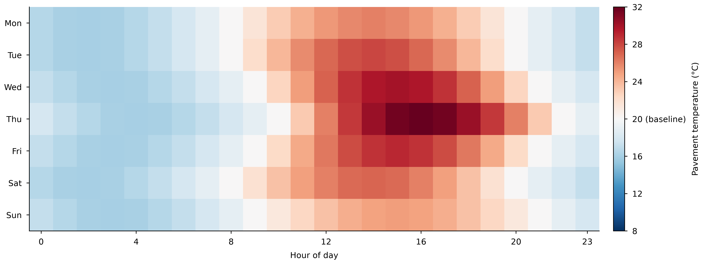

# Diverging color scale

A diverging color scale shows departures from a reference value, with one hue below it and another above. Center the scale on the reference and give both sides the same half-range, so a degree of departure has the same color distance on either side. One end of the color bar may then stay partly unused.

- Set `BASELINE` to the reference value. `draw_week` takes the half-range from the largest absolute departure; when several panels are compared, compute it from all of them together.
- `TwoSlopeNorm` with the observed extremes as limits stretches each side on its own. A degree then spans more color on the side with the smaller range.
- The color bar takes its limits from the image, and `labels[len(ticks) // 2]` marks the center tick as the baseline.
