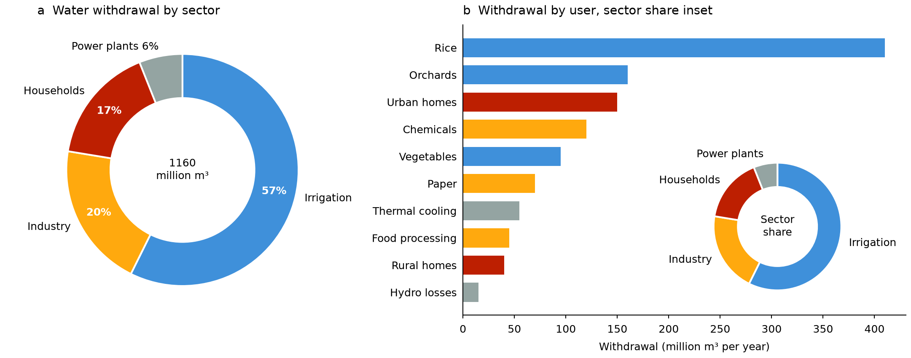

# Donut chart

A donut chart shows a few parts of one whole as segments of a ring, with room for the total in the hole. Use it when readers need the rough split, not exact comparisons between parts. A small donut can also sit in an empty corner of a bar chart and serve as the color key for bars grouped by part. The same color must mean the same part in the ring and in the bars.

- `donut` starts at 12 o'clock and runs clockwise (`startangle=90`, `counterclock=False`) in the order of `SECTORS`. Put the largest or the reference part first.
- Names go outside the ring, because most names are wider than the ring. Shares at or above `INSIDE_ABOVE` % go inside their segment; smaller shares follow the name.
- `whole_percent` rounds by largest remainder, so the printed shares add up to 100.
