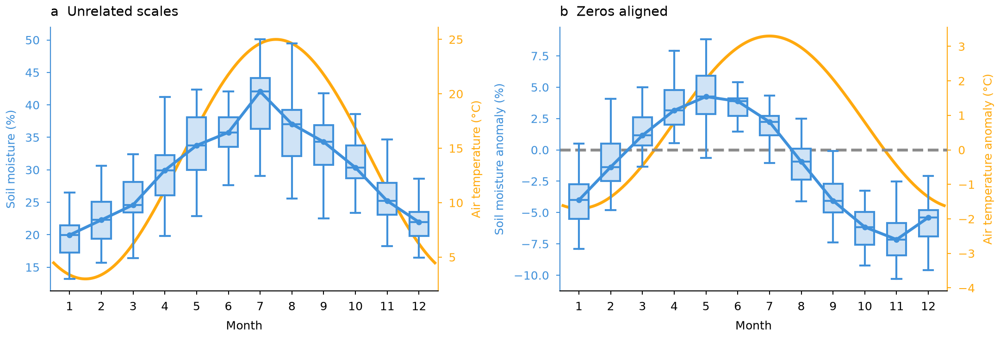

# Dual y-axis

A second y axis puts two quantities with different units on one x axis: here monthly boxes of soil moisture on the left and an air temperature curve on the right. Each axis, its ticks and its label take the color of their series, so no legend is needed. The two scales are unrelated, so draw no grid; a grid would belong to one axis only. When both quantities change sign, align their zeros as in panel b.

- `twinx()` draws the new axes last. `curve` raises the box axes with `set_zorder` and hides its background with `ax.patch.set_visible(False)`, so the boxes sit in front of the curve.
- `align_zero` lowers one axis's lower limit so zero sits at the same height on both axes. Both ranges must include zero.
- `color_axis` colors one spine with its ticks, tick labels and axis label. Call it once for each side.
