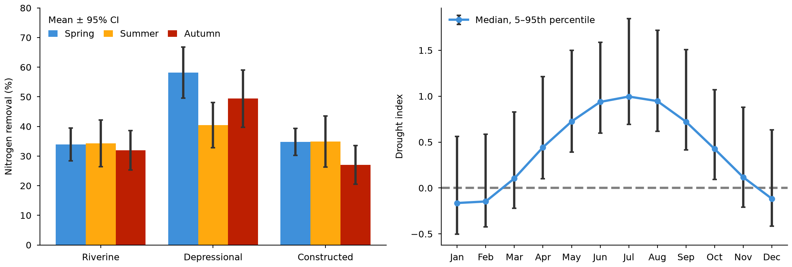

# Error bars

Error bars show the interval around a single estimate, such as a group mean or a point in a short series. The left panel puts symmetric 95% confidence intervals on grouped bars. The right panel puts an asymmetric 5th–95th percentile interval on a monthly median. Papers use different intervals, so print which one each panel shows, in the legend title or label.

- `yerr` takes distances from the point, not interval ends. Pass one array for a symmetric interval and `[value - low, high - value]` for an asymmetric one.
- `fmt="none"` draws only the bars, for use on top of `ax.bar`; `fmt="-o"` adds points and a line.
- `bars_with_ci` uses t(0.975, 7) = 2.365 for eight replicates. Change the constant when `REPLICATES` changes.
