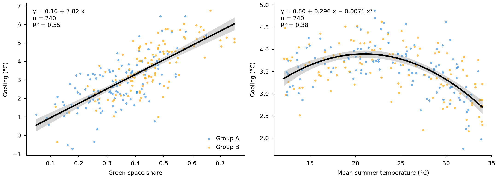

# Fitted line

A fitted line over a scatter shows a model of the points, not only the points. Draw the fit with its confidence band, and print the equation, n and R² beside it. When the points are colored by group but one fit uses all of them, say so in the caption.

- `polynomial_fit(x, y, degree, grid)` returns the coefficients (highest power first), the fitted values, the half-width of the 95% band and R². `grid` runs from `x.min()` to `x.max()`, so the line does not extrapolate.
- The band is the confidence interval of the fitted mean. It is narrower than a prediction interval for single points, so name the one you draw in the caption.
- `t_quantile` stands in for `scipy.stats.t.ppf(0.975, df)`. `term` prints a coefficient with a true minus sign (−) and a space on both sides of the operator.
