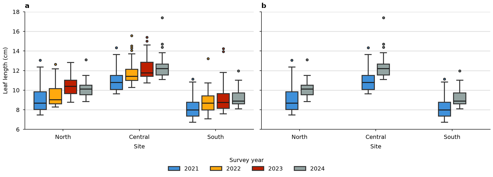

# Grouped box plot

A grouped box plot places several box plots side by side at each category, one color per series. Use it to compare distributions across two categorical variables at once, such as site on the x-axis and survey year in color. One legend names the colors.

- `offsets` splits `group_width` into one slot per series, and `FILL` is the share of a slot taken by its box. For boxes of equal width in a panel with fewer series, scale `group_width` by the series count (`GROUP_WIDTH * 2 / len(YEARS)` in b), and give panels with the same number of categories the same width.
- `boxplot` marks as outliers the points beyond 1.5 × IQR from the box. Pass `whis` to change the rule, and state it in the caption.
- `boxplot` returns no labeled artists, so the legend is built from `Patch` handles.
