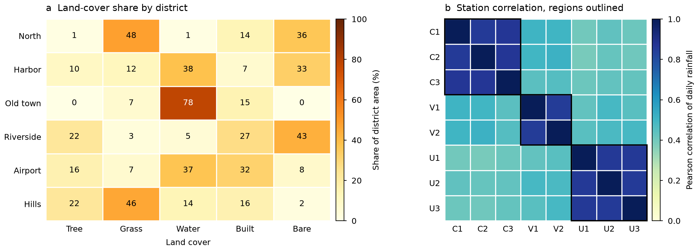

# Heatmap

A heatmap shows one value for every pair of row and column categories as a colored cell. Panel a prints each value in its cell, so readers do not have to match colors against the color bar. Panel b is a symmetric matrix with the same stations on both axes, ordered by region, and each region outlined on the diagonal.

- Fix `vmin` and `vmax` to the range the quantity can take, so two heatmaps of the same quantity share a scale. With `fmt`, the cell text turns white where the cell's luminance is below `LIGHT_TEXT_ABOVE`.
- `outline_blocks` takes the block sizes from `GROUPS`, so the row order must follow the groups. It draws above the white cell grid (`zorder=3`), and `clip_on=False` stops the panel edge from cutting the outer line.
- `land_cover` rounds shares with the largest-remainder method, so each printed row adds up to 100.
