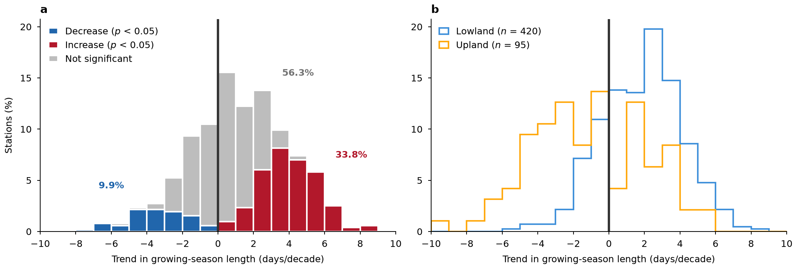

# Histogram

A histogram shows how one variable is distributed across many stations, cells or samples. Give the y-axis in percent of all values, so readers can compare groups of different size. Put a bin edge at any threshold that matters, such as zero, so no bar mixes values from both sides. Panel a stacks the bars by significance class; panel b draws two groups as step outlines on the same bins.

- `EDGES` sets every bin. Check that the threshold is one of the edges, and use the same edges in every panel that readers compare.
- `weights=100 / n` turns counts into percentages. In a, `n` is all stations, so the stacked bars add to 100%. In b, each group uses its own `n`.
- `hist` drops values outside the bins without a warning, and the percentages then add to less than 100. `check_range` raises an error instead.
