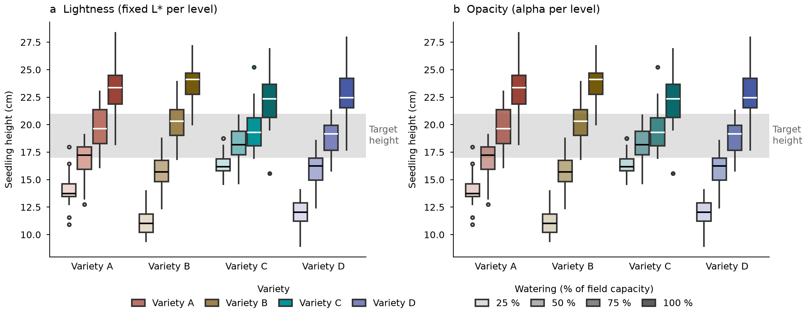

# Hue and lightness encoding

Lightness within a hue shows an ordered second category, such as a dose or a level, inside each series. Each series gets its own hue, and the levels run from light to dark at the same CIELAB lightness (L*) in every hue. A two-part legend names the series with hue swatches and the levels with a gray ramp at the same L* values, so a box in any hue can be matched to the ramp. Panel b uses opacity instead; opacity blends each box with whatever lies behind it, so one level can show two colors.

- `LIGHTNESS` holds one L* per level, light to dark, and every hue uses the same values. In this example the levels are about 15 L* apart.
- `level_chroma` lowers chroma as lightness rises, and `shade` lowers it further until the color fits in sRGB. With one chroma for all levels, light cyans and yellows stay vivid while other hues turn pale.
- `VARIETIES` gives each series a hue angle in CIE LCh, in degrees; here they are at least 50° apart. The median line turns white below L* 60.
