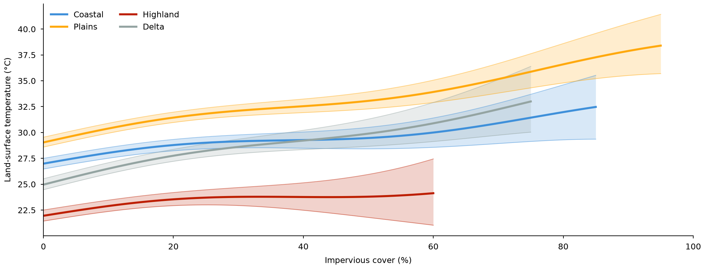

# Band around a line

Translucent bands in each line's color show the spread of several series that overlap. Here four regions each have a median line and a band from the 10th to the 90th percentile of 200 draws. The figure does not say what the band is, so the caption must; if the band is a confidence interval, name it in the legend title. Each band ends where its series ends, and the legend lists the lines only.

- Draw all bands before all lines, so no band covers another series' line.
- `BAND_ALPHA` sets the fill opacity. Overlapping bands blend, so keep it at about 0.25 or below with four series. `EDGE_ALPHA` sets a thin band outline in the line color; 0 removes it.
- The last value of each `REGIONS` entry is the highest observed x, where the line and its band stop.
