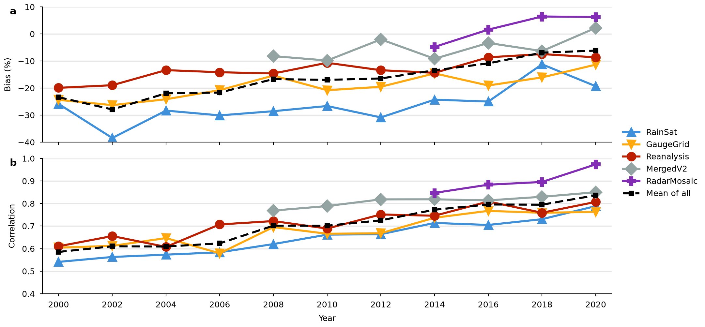

# Line chart

A line chart joins the values of each series along an ordered axis, such as years. To compare several series on two or more metrics, stack one panel per metric on a shared x-axis and use one legend for all panels. Give each series its own color and its own marker, the mean line included, so the lines stay apart in grayscale.

- Years without data are `NaN`. `plot` breaks the line at a `NaN`, so a series that starts later is not drawn through the years it lacks.
- `np.nanmean` averages only the series present in each year, so the mean can step when a series enters without any series changing. State in the caption which series enter the mean.
- `METRICS` fixes each panel's y limits. Choose them from the data range, or values beyond them are cut off at the frame.
